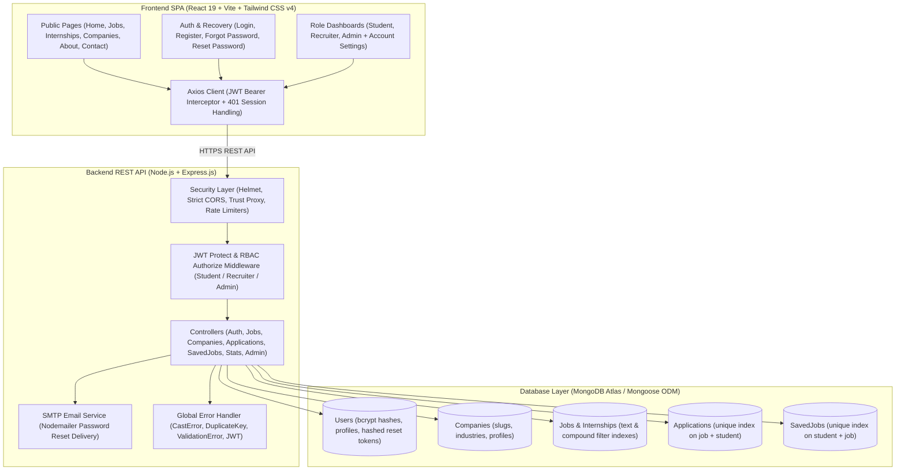

# JobPortal — Jobs & Internships Discovery Platform

A full-stack **MERN** (MongoDB, Express.js, React.js, Node.js) web application for discovering full-time technology jobs and internships, managing recruitment pipelines, and tracking candidate applications.

---

## Live Links & Repository

| Resource | Platform | URL |
| :--- | :--- | :--- |
| **Live Web App** | Render Static Site | https://job-portal-web-8a3p.onrender.com |
| **Backend REST API** | Render Web Service | https://job-portal-api-halo.onrender.com |
| **API Health Check** | Render Web Service | https://job-portal-api-halo.onrender.com/api/health |
| **GitHub Repository** | GitHub (`main` branch) | https://github.com/indrasingh29/job-internship-portal |

---

## Key Features

- **Jobs & Internships Discovery:** Debounced search by job title, company name, or required skills, location search, workplace mode (`Remote`, `Hybrid`, `Onsite`), job type (`Full-time`, `Part-time`, `Contract`, `Internship`), domain category, fresher eligibility, minimum salary/stipend filters, sorting, and pagination.
- **Company Directory:** Browse hiring companies with industry filters, headquarters/scale details, and live active opening counts.
- **Role-Based Dashboards:**
  - **Student / Candidate:** Dashboard overview with live opportunities, embedded Jobs & Internships browsers, application history with real-time status tracking (`Applied`, `Shortlisted`, `Selected`, `Rejected`), saved-job bookmarks, profile & education editor, and password management.
  - **Recruiter / Employer:** Create, edit, close/reopen, and delete job or internship postings, manage company profiles, review candidate profiles & resumes, update applicant statuses, and inspect Recharts pipeline analytics.
  - **Administrator:** Manage users (search, role/status filters, activate/deactivate, cascade delete), moderate job listings, and monitor live service & database telemetry.
- **Authentication, Security & Password Recovery:**
  - JWT authentication with `bcryptjs` password hashing and strict environment-based secret resolution in production (`JWT_SECRET`).
  - Complete **Forgot Password** and **Reset Password** workflow with cryptographically random, SHA-256 hashed, single-use, 15-minute expiring tokens delivered via SMTP (`nodemailer`).
  - Authenticated **Change Password** verification (`PUT /api/auth/change-password`).
  - Helmet security headers, strict production CORS whitelist, reverse-proxy-aware rate limiting (`trust proxy`), NoSQL operator injection guards, and HTTP/HTTPS URL sanitization.

---

## System Architecture



---

## Technology Stack

### Frontend (`client/`)
- **React 19 + Vite 8** — Fast ESM bundling and single-page application routing (`react-router-dom` v7).
- **Tailwind CSS v4** — Utility-first design system with custom violet brand palette and accessible keyboard focus styles.
- **Axios** — Centralized HTTP client with Bearer token injection and 401 session cleanup.
- **Recharts** — Interactive SVG bar and donut charts for recruiter hiring analytics.
- **Lucide React** — Consistent icon system.

### Backend (`server/`)
- **Node.js & Express.js** — Modular REST API with centralized error handling.
- **MongoDB & Mongoose ODM** — Schema validation, relational population, compound unique indexes, and text search indexes.
- **JSON Web Tokens (`jsonwebtoken`) & `bcryptjs`** — Stateless authentication and salted password hashing.
- **Nodemailer** — Configurable SMTP email delivery for password reset links.
- **Helmet, CORS & `express-rate-limit`** — Security headers, origin allowlisting, and endpoint rate limiting.

---

## Repository Structure

```text
job-internship-portal/
├── client/
│   ├── public/
│   │   └── _redirects                # Static SPA rewrite rule
│   └── src/
│       ├── components/               # Navbar, Footer, OpportunityCard, OpportunityDiscovery, CompanyCard, AccountSettingsPanel
│       ├── constants/                # Shared opportunity categories
│       ├── context/                  # AuthContext (session, saved jobs synchronization, auth actions)
│       ├── pages/                    # Home, Jobs, Internships, Companies, Auth, Forgot/Reset Password, Dashboards
│       ├── services/                 # Axios API client
│       └── utils/                    # Safe external URL validator
├── server/
│   ├── src/
│   │   ├── config/                   # MongoDB connection (no silent fallback in prod) & JWT helpers
│   │   ├── controllers/              # Auth, Jobs, Companies, Applications, SavedJobs, Stats, Admin
│   │   ├── middleware/               # protect, authorize, rate limiters, error middleware
│   │   ├── models/                   # User, Company, Job, Application, SavedJob
│   │   ├── routes/                   # Express API routers
│   │   ├── seed/                     # Idempotent database seeder (50 companies, 52 listings, demo accounts)
│   │   └── utils/                    # Email service, input/URL helpers, automated API test suite
│   └── .env.example                  # Backend environment template
└── render.yaml                       # Render Infrastructure-as-Code blueprint
```

---

## Key API Endpoints

| Area | Endpoints |
| :--- | :--- |
| **Health** | `GET /api/health` |
| **Auth & Recovery** | `POST /api/auth/register`, `POST /api/auth/login`, `GET /api/auth/me`, `PUT /api/auth/profile`, `PUT /api/auth/change-password`, `POST /api/auth/forgot-password`, `GET /api/auth/reset-password/:token`, `POST /api/auth/reset-password/:token` |
| **Jobs & Internships** | `GET /api/jobs`, `GET /api/jobs/:id`, `GET /api/jobs/recruiter/my-postings`, `POST /api/jobs`, `PUT /api/jobs/:id`, `DELETE /api/jobs/:id` |
| **Companies** | `GET /api/companies`, `GET /api/companies/meta/industries`, `GET /api/companies/:identifier`, `PUT /api/companies/my-company` |
| **Applications** | `POST /api/applications/apply/:jobId`, `GET /api/applications/my-applications`, `GET /api/applications/job/:jobId`, `PUT /api/applications/:applicationId/status` |
| **Saved Jobs** | `GET /api/saved-jobs`, `GET /api/saved-jobs/check/:jobId`, `POST /api/saved-jobs/:jobId`, `DELETE /api/saved-jobs/:jobId` |
| **Stats & Admin** | `GET /api/stats/public`, `GET /api/stats/student`, `GET /api/stats/recruiter`, `GET /api/stats/admin`, `GET /api/admin/users`, `PUT /api/admin/users/:id/toggle-status`, `DELETE /api/admin/users/:id`, `GET /api/admin/jobs` |

---

## Environment Variables

### Backend (`server/.env`)

| Variable | Required | Description |
| :--- | :--- | :--- |
| `PORT` | No (default `5000`) | HTTP port for the Express server |
| `NODE_ENV` | Yes | `development`, `test`, or `production` |
| `MONGODB_URI` | Yes (production) | MongoDB Atlas connection string (`.../job_portal?retryWrites=true&w=majority`) |
| `JWT_SECRET` | Yes (production) | Secret used to sign and verify JWTs (no fallback in production) |
| `JWT_EXPIRES_IN` | No (default `7d`) | JWT expiration window |
| `CLIENT_URL` | Yes (production) | Whitelisted frontend origin (e.g. `https://job-portal-web-8a3p.onrender.com`) |
| `ALLOW_IN_MEMORY_DB` | No | Must be `false` in production; `true` allows local in-memory MongoDB in dev/test |
| `SMTP_HOST` | Yes (production) | SMTP server hostname for password reset emails |
| `SMTP_PORT` | No (default `587`) | SMTP port |
| `SMTP_SECURE` | No (default `false`) | Set `true` for TLS on port `465` |
| `SMTP_USER` | Yes (production) | SMTP username |
| `SMTP_PASS` | Yes (production) | SMTP password or app password |
| `EMAIL_FROM` | No | Sender address for transactional emails |

### Frontend (`client/.env`)

| Variable | Required | Description |
| :--- | :--- | :--- |
| `VITE_API_URL` | Yes | Backend API base URL (e.g. `http://localhost:5000/api` locally or `https://job-portal-api-halo.onrender.com/api` in production) |

---

## Local Development & Testing

### 1. Backend

```bash
cd server
npm install
cp .env.example .env   # On Windows PowerShell: copy .env.example .env
npm run seed           # Seeds 50 companies, 52 listings, and demo accounts
npm test               # Runs 23-case automated API & security verification suite
npm run dev            # Starts API on http://localhost:5000
```

### 2. Frontend

```bash
cd client
npm install
cp .env.example .env   # On Windows PowerShell: copy .env.example .env
npm run lint           # Runs oxlint across src/
npm run build          # Builds production bundle into client/dist/
npm run dev            # Starts Vite dev server on http://localhost:5173
```

---

## Render Production Deployment

1. **Backend Web Service (`job-portal-api`):**
   - Root Directory: `server` | Build Command: `npm install` | Start Command: `npm start` | Health Check Path: `/api/health`
   - Required Environment Variables: `NODE_ENV=production`, `ALLOW_IN_MEMORY_DB=false`, `PORT=5000` (or Render default), `MONGODB_URI`, `JWT_SECRET`, `JWT_EXPIRES_IN=7d`, `CLIENT_URL=https://job-portal-web-8a3p.onrender.com`, and `SMTP_*` / `EMAIL_FROM`.
2. **Frontend Static Site (`job-portal-web`):**
   - Root Directory: `client` | Build Command: `npm install && npm run build` | Publish Directory: `dist`
   - Environment Variable: `VITE_API_URL=https://job-portal-api-halo.onrender.com/api`
   - Redirects/Rewrites Rule: Source `/*` → Destination `/index.html` → Action `Rewrite` (`200`) for direct SPA route navigation and refreshes.
