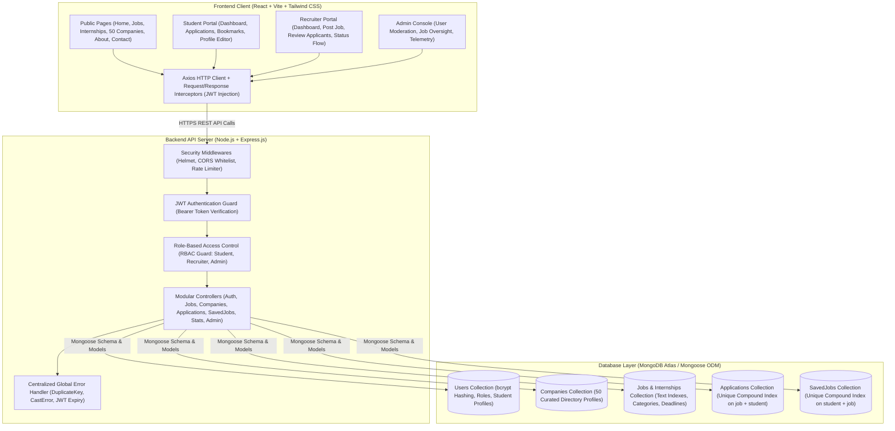

# Job & Internship Portal — MERN Stack

> **B.Tech Computer Science & Engineering — Minor Project**  
> **Academic Session:** 2026–27  
> **Project Owner / Developer:** Indra Singh Jeena  
> **Copyright Notice:** **© 2026 Indra Singh Jeena. All Rights Reserved.**

---

## 1. Executive Summary & Project Mission

The **Job & Internship Portal** is a production-minded, full-featured web application architected using the **MERN Stack** (MongoDB, Express.js, React.js with Vite, Node.js). Designed to fulfill the official B.Tech CSE Minor Project synopsis, the platform provides a complete ecosystem for:

- **Students / Job Seekers:** Discover tech openings, filter by fresher eligibility and remote workplace modes, bookmark opportunities, and submit tracked applications with resume links and customized cover letters.
- **Recruiters / Employers:** Manage company profiles, create and publish job/internship vacancies, review candidate profiles and resume links, and update hiring statuses.
- **System Administrators:** Oversee platform telemetry, audit and deactivate abusive accounts, remove outdated listings, and monitor cross-platform statistics.
- **Public Directory:** Explore 50 curated tech employer profiles (25 Global MNCs, 19 Indian IT/FinTech leaders, and 6 high-growth startups) with 52 distinct job/internship listings.

---

## 2. System Architecture Diagram



---

## 3. Technology Stack & Packages

### Frontend (`client/`)
- **React.js 18+ (Vite):** Lightning-fast development server, optimized ESM bundling, zero-config hot module replacement.
- **Tailwind CSS v4:** Modern utility-first CSS design system with custom violet/indigo gradients and deep navy typography.
- **React Router DOM v6:** Client-side declarative routing, nested routes, and protected route guards.
- **Axios:** Centralized HTTP requests with automatic token injection and 401 session expiration handling.
- **Recharts:** Responsive SVG data visualization for recruiter pipeline analytics and applicant status distributions.
- **Lucide React:** Consistent, lightweight, accessible iconography.

### Backend (`server/`)
- **Node.js & Express.js:** Fast, asynchronous, non-blocking REST API framework.
- **MongoDB & Mongoose ODM:** Schema validation, relational population (`.populate()`), compound indexes, and query optimization.
- **JWT (`jsonwebtoken`):** Stateless cryptographic tokens with configurable expiration (`7d`).
- **Bcryptjs:** Pure JavaScript password hashing with 10 salt rounds (no native compilation dependencies).
- **Helmet & CORS:** HTTP security headers and strictly whitelisted client origins.
- **Express Rate Limit:** Rate-limiting middleware safeguarding sensitive authentication endpoints.

---

## 4. Key Functional Modules

| Module | Features & Capabilities |
| :--- | :--- |
| **Authentication & RBAC** | Student & Recruiter self-registration; public endpoint blocked from creating admin accounts; bcrypt password hashing; JWT token issue & verification; profile updates. |
| **50-Company Directory** | 50 curated technology company profiles (25 Global MNCs, 19 Indian IT/Tech giants, 6 Startups); industry sector filtering; search by company name; opening counts. |
| **Jobs & Internships Discovery** | 52 distinct opportunities; filter by remote/hybrid/onsite, fresher eligibility, domain category, job type, and salary/stipend; pagination and sorting. |
| **Application Pipeline** | One-click apply modal with cover message and resume link; **database-level duplicate prevention** via unique compound index; deadline enforcement. |
| **Student Dashboard** | Profile completion progress bar; application history table with live status badges (`Applied`, `Shortlisted`, `Selected`, `Rejected`); saved opportunities bookmarking. |
| **Recruiter Dashboard** | Opportunity creation modal; postings management table (toggle active/closed, delete); applicant review drawer; candidate pipeline charts with Recharts. |
| **Admin Console** | System telemetry; user management (search, role filtering, active/deactivate toggle, delete); job moderation table (remove invalid listings). |

---

## 5. Repository Structure

```
job-internship-portal/
├── client/                      # React Frontend (Vite + Tailwind CSS)
│   ├── public/
│   │   └── _redirects           # Render Static Site SPA rewrite rule
│   ├── src/
│   │   ├── components/          # Reusable UI (Navbar, Footer, OpportunityCard, CompanyCard, SkeletonLoader)
│   │   ├── context/             # AuthContext (login, register, logout, role state)
│   │   ├── pages/               # Public and dashboard views
│   │   ├── services/            # Centralized Axios instance (api.js)
│   │   ├── App.jsx              # Application router and protected route wrappers
│   │   ├── index.css            # Tailwind directives and scrollbar utilities
│   │   └── main.jsx             # React DOM entrypoint
│   ├── .env.example             # Client environment template
│   ├── index.html               # HTML5 document with Inter font & favicon
│   ├── package.json             # Frontend dependencies
│   └── vite.config.js           # Vite configuration
│
├── server/                      # Node.js + Express Backend
│   ├── src/
│   │   ├── config/              # MongoDB connection (db.js) with Atlas + local dev fallback
│   │   ├── controllers/         # Modular controllers (auth, jobs, companies, apps, savedJobs, stats, admin)
│   │   ├── middleware/          # JWT auth guard, RBAC middleware, error handlers, rate limiters
│   │   ├── models/              # Mongoose schemas (User, Company, Job, Application, SavedJob)
│   │   ├── routes/              # Express routers
│   │   ├── seed/                # Idempotent seeder (50 companies, 52 jobs, 3 demo accounts)
│   │   ├── utils/               # Automated end-to-end test suite (runTests.js)
│   │   ├── app.js               # Express application configuration
│   │   └── server.js            # Server entrypoint and graceful shutdown
│   ├── .env.example             # Server environment template
│   └── package.json             # Backend dependencies & npm scripts
│
├── .gitignore                   # Excludes node_modules, .env, and dist/
├── render.yaml                  # Render Infrastructure-as-Code blueprint
└── README.md                    # Project documentation
```

---

## 6. Local Development Setup Guide

### Prerequisites
- Node.js `v18+` or `v20+` (verified on `v24.21.0`)
- npm `v9+` (verified on `v12.0.2`)
- MongoDB Atlas cluster URL (or utilize the automatic local in-memory fallback)

### Step 1: Clone or Navigate to Project
```powershell
cd C:\Users\indra\.gemini\antigravity\scratch\job-internship-portal
```

### Step 2: Configure & Run Backend Server
```powershell
cd server
npm install

# Setup environment file
copy .env.example .env

# Seed 50 companies, 52 opportunities, and 3 demo accounts
npm run seed

# Run automated verification tests
npm test

# Start development API server (Runs on port 5000)
npm run dev
```

### Step 3: Configure & Run Frontend Client
Open a second terminal window:
```powershell
cd C:\Users\indra\.gemini\antigravity\scratch\job-internship-portal\client
npm install

# Setup environment file
copy .env.example .env

# Start Vite development server (Runs on http://localhost:5173)
npm run dev
```

Visit **`http://localhost:5173`** in your browser.

---

## 7. Demo Credentials

For quick evaluation during college project presentations and vivas, the login screen provides **1-Click Quick Fill** buttons:

| Role | Email | Password | Primary Access |
| :--- | :--- | :--- | :--- |
| **Demo Student** | `student@demo.com` | `Student@123` | Student Dashboard, Applications, Bookmarks, Profile Editor |
| **Demo Recruiter** | `recruiter@demo.com` | `Recruiter@123` | Recruiter Panel, Post Opportunities, Review Candidates |
| **Demo Admin** | `admin@demo.com` | `Admin@123` | Admin Console, User Moderation, Job Oversight, Telemetry |

---

## 8. Automated Test Results

The backend includes an end-to-end automated API verification test suite (`npm test` in `server/`). All tests execute with zero mock servers against the active Mongoose models:

```
====================================================
  Job & Internship Portal - Automated Test Suite
====================================================
  [PASS] Backend Health Check (/api/health)
  [PASS] Public Platform Stats (/api/stats/public)
  [PASS] Company Directory Listing (/api/companies) (Found 50 companies)
  [PASS] Job Search & Filtering (/api/jobs) (Retrieved 10 jobs)
  [PASS] Internship Search & Discovery (Retrieved 10 internships)
  [PASS] Student Authentication (/api/auth/login)
  [PASS] Recruiter Authentication (/api/auth/login)
  [PASS] Admin Authentication (/api/auth/login)
  [PASS] RBAC Security: Student blocked from Admin routes (HTTP 403)
  [PASS] RBAC Authorization: Admin permitted to Admin routes
  [PASS] Student Dashboard Stats (/api/stats/student)
  [PASS] Recruiter Dashboard Stats (/api/stats/recruiter)
  [PASS] Recruiter Post New Opportunity (/api/jobs)
  [PASS] Student Application Submission
  [PASS] Duplicate Application Prevention Check (HTTP 409 Conflict)
  [PASS] Recruiter View Job Applicants
  [PASS] Recruiter Update Applicant Status (Shortlisted)
  [PASS] Recruiter Delete Opportunity Cleanup
====================================================
  Test Suite Completed: 18 / 18 PASSED
====================================================
```

---

## 9. Render & MongoDB Atlas Deployment Guide

### A. MongoDB Atlas Database Setup
1. Sign in to [MongoDB Atlas](https://www.mongodb.com/cloud/atlas).
2. Create a free shared cluster (M0 sandbox).
3. Under **Database Access**, create a database user (e.g., `portal_admin`) with a strong password.
4. Under **Network Access**, add IP address `0.0.0.0/0` (Allow access from anywhere for cloud deployment).
5. Click **Connect** -> **Connect your application** (Drivers: Node.js) and copy the URI:
   ```
   mongodb+srv://<username>:<password>@cluster0.xxxxx.mongodb.net/job_portal?retryWrites=true&w=majority
   ```

### B. Deploy Backend on Render (Web Service)
1. Sign in to [Render Dashboard](https://dashboard.render.com).
2. Click **New +** -> **Web Service**.
3. Connect your GitHub repository.
4. Configure service settings:
   - **Name:** `job-portal-api`
   - **Root Directory:** `server`
   - **Environment:** `Node`
   - **Build Command:** `npm install`
   - **Start Command:** `npm start`
5. Add Environment Variables:
   - `NODE_ENV`: `production`
   - `MONGODB_URI`: `<Your MongoDB Atlas connection string>`
   - `JWT_SECRET`: `<A strong random 32-character string>`
   - `CLIENT_URL`: `https://job-portal-web.onrender.com` (Your frontend URL)
   - `ALLOW_IN_MEMORY_DB`: `false`
6. Click **Create Web Service**. Note the deployed URL (e.g. `https://job-portal-api.onrender.com`).

### C. Deploy Frontend on Render (Static Site)
1. Click **New +** -> **Static Site**.
2. Connect the same GitHub repository.
3. Configure settings:
   - **Name:** `job-portal-web`
   - **Root Directory:** `client`
   - **Build Command:** `npm install && npm run build`
   - **Publish Directory:** `dist`
4. Add Environment Variable:
   - `VITE_API_URL`: `https://job-portal-api.onrender.com/api` (Points to deployed backend)
5. Verify SPA rewrite rule:
   - The file `client/public/_redirects` contains `/* /index.html 200`, ensuring page reloads on `/jobs`, `/student/dashboard`, etc., do not return 404.
6. Click **Create Static Site**.

---

## 10. Project Viva & Presentation Q&A

**Q1: How do you prevent a student from submitting duplicate applications to the same opportunity?**  
> *Answer:* At the database level, we enforce a **compound unique index** on the Mongoose `Application` schema:  
> `applicationSchema.index({ job: 1, student: 1 }, { unique: true });`  
> In addition, the controller performs a pre-flight query checking if an application already exists and returns an HTTP 409 Conflict with a clear message.

**Q2: How is role-based authorization implemented?**  
> *Answer:* We utilize a two-tier middleware approach:  
> 1. `protect`: Verifies the cryptographic signature of the Bearer JWT token and attaches the authenticated `req.user`.  
> 2. `authorize(...roles)`: Inspects `req.user.role`. If a student attempts to query `/api/admin/*`, the middleware intercepts the request and terminates it with an HTTP 403 Forbidden.

**Q3: How are passwords secured in the database?**  
> *Answer:* Passwords are never stored in plaintext. In `User.js`, a Mongoose `pre('save')` hook hashes the password with 10 salt rounds using `bcryptjs`. Furthermore, the `password` field is designated with `select: false` so that standard user queries do not expose password hashes in API payloads.

**Q4: How does the frontend handle token expiration?**  
> *Answer:* An Axios response interceptor intercepts any HTTP 401 Unauthorized responses. If an expired token is detected, it purges `localStorage` and dispatches an `auth-logout` event that immediately updates React state and redirects the user to the login screen.

---

## 11. Copyright & Academic Attribution

**© 2026 Indra Singh Jeena. All Rights Reserved.**

*This project is submitted as an academic Minor Project towards the partial fulfillment of the degree of Bachelor of Technology in Computer Science & Engineering.*
